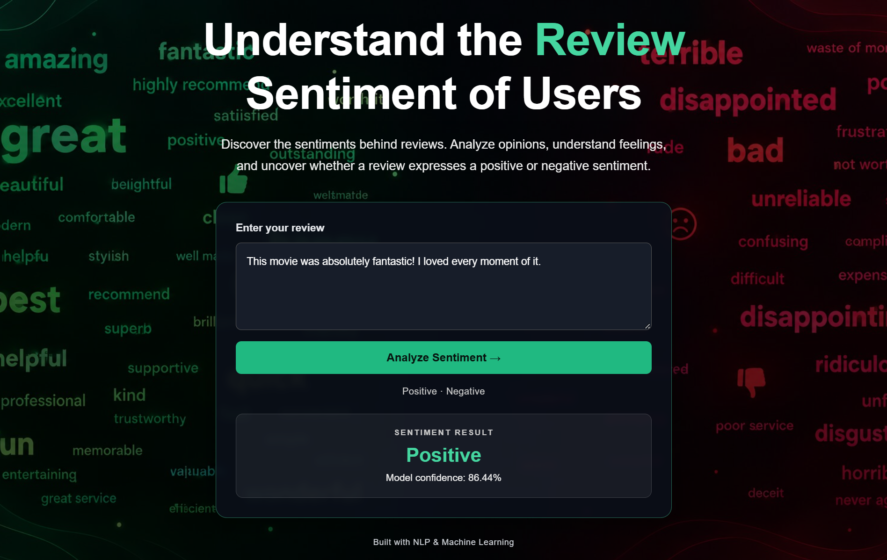

# Sentiment-Guesser 💬

### An NLP-powered sentiment analysis web application built with Machine Learning.

<p align="center">
  <a href="https://sentiment-guesser.onrender.com">
    
  </a>
</p>

<p align="center">
  
  
  
  
</p>


## 📌 Overview

**Sentiment-Guesser** is a machine learning-based web application that analyzes text and predicts whether its sentiment is **Positive** or **Negative**.

The project uses Natural Language Processing (NLP) techniques, particularly TF-IDF vectorization, combined with Logistic Regression to classify user-submitted reviews.

What started as a machine learning experiment in Jupyter Notebook was developed into a complete web application using Flask and deployed on Render.

## ✨ Features

- **Real-Time Sentiment Prediction:** Analyze text reviews and receive instant predictions.
- **NLP-Based Classification:** Uses TF-IDF to convert text into numerical features.
- **Machine Learning Model:** Uses a trained Logistic Regression classifier.
- **Confidence Score:** Displays the model's prediction confidence.
- **Interactive Web Interface:** Simple and user-friendly interface built with HTML and CSS.
- **Live Deployment:** Accessible online through Render.

## 🚀 Live Demo

Try the application here:

[**Open Sentiment-Guesser**](https://sentiment-guesser.onrender.com)

Enter a review and discover whether its sentiment is positive or negative.

## 🖥️ Application Preview

<p align="center">
  
</p>

## 🧠 Machine Learning Workflow

The project follows an end-to-end machine learning workflow:

1. **Data Collection:** Used labelled positive and negative review datasets.
2. **Data Cleaning:** Handled duplicate records and prepared the text data.
3. **Text Vectorization:** Applied TF-IDF to transform textual data into numerical representations.
4. **Model Training:** Trained Logistic Regression and Multinomial Naive Bayes classifiers.
5. **Model Evaluation:** Compared the models using accuracy, precision, recall, and F1-score.
6. **Model Saving:** Saved the trained machine learning pipeline using Joblib.
7. **Web Integration:** Integrated the saved model into a Flask application.
8. **Deployment:** Deployed the application using Gunicorn and Render.

## 📊 Model Evaluation

Two machine learning algorithms were evaluated during model comparison.

| Metric    | Logistic Regression | Naive Bayes |
| --------- | ------------------: | ----------: |
| Accuracy  |          **94.70%** |      91.59% |
| Precision |          **96.41%** |      90.46% |
| Recall    |              96.08% |  **98.49%** |
| F1-Score  |          **96.25%** |      94.30% |

**Selected Model: Logistic Regression**

Logistic Regression achieved the higher accuracy, precision, and F1-score in the evaluated experiment, making it the selected model for the web application.

## 🛠️ Technology Stack

| Category                    | Technologies  |
| --------------------------- | ------------- |
| Programming Language        | Python        |
| Data Processing             | NumPy, Pandas |
| Data Visualization          | Matplotlib    |
| Natural Language Processing | TF-IDF        |
| Machine Learning            | Scikit-learn  |
| Model Persistence           | Joblib        |
| Backend                     | Flask         |
| Frontend                    | HTML, CSS     |
| Production Server           | Gunicorn      |
| Deployment                  | Render        |
| Version Control             | Git, GitHub   |

## 📂 Project Structure

```text
Sentiment-Guesser/
│
├── app.py
├── requirements.txt
├── .gitignore
├── .python-version
│
├── sentiment_analysis.ipynb
│
├── TestReviews.csv
├── TrainingDataNegative.txt
├── TrainingDataPositive.txt
│
├── saved_model/
│   └── sentiment_model.pkl
│
├── templates/
│   └── index.html
│
└── static/
    ├── style.css
    └── positivenegativeimage.jpg
```

## 🎯 Learning Outcomes

Through this project, I gained practical experience with:

- Text preprocessing and feature extraction.
- TF-IDF vectorization for NLP tasks.
- Training and evaluating machine learning classifiers.
- Comparing classification algorithms.
- Saving and loading trained ML models.
- Integrating machine learning models with Flask.
- Managing project dependencies and virtual environments.
- Version control using Git and GitHub.
- Deploying a Python web application using Render.

## 🔮 Future Improvements

- Experiment with additional NLP techniques.
- Explore advanced machine learning and deep learning models.
- Improve the user interface and application experience.
- Expand the training dataset to improve generalization.

## 👨‍💻 Author

**Manav Saxena**

B.Tech Computer Science and Engineering Student | Aspiring Data Scientist

- GitHub: [@manavs-codes](https://github.com/manavs-codes)
- Project Repository: [Sentiment-Guesser](https://github.com/manavs-codes/Sentiment-Guesser)
- Live Application: [Try it here](https://sentiment-guesser.onrender.com)

---

⭐ If you find this project interesting, consider giving the repository a star!

*Built as part of my journey in Machine Learning, Natural Language Processing, and Data Science.*
